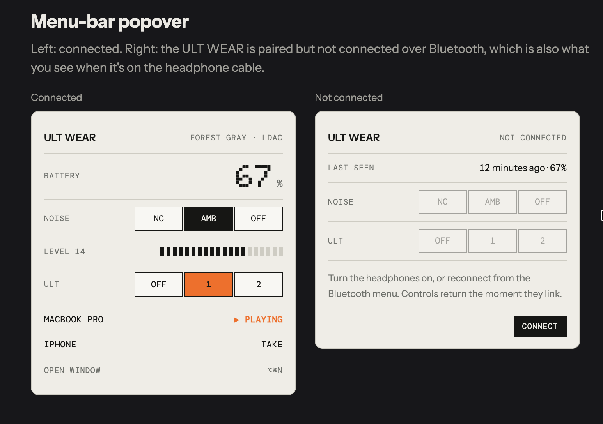
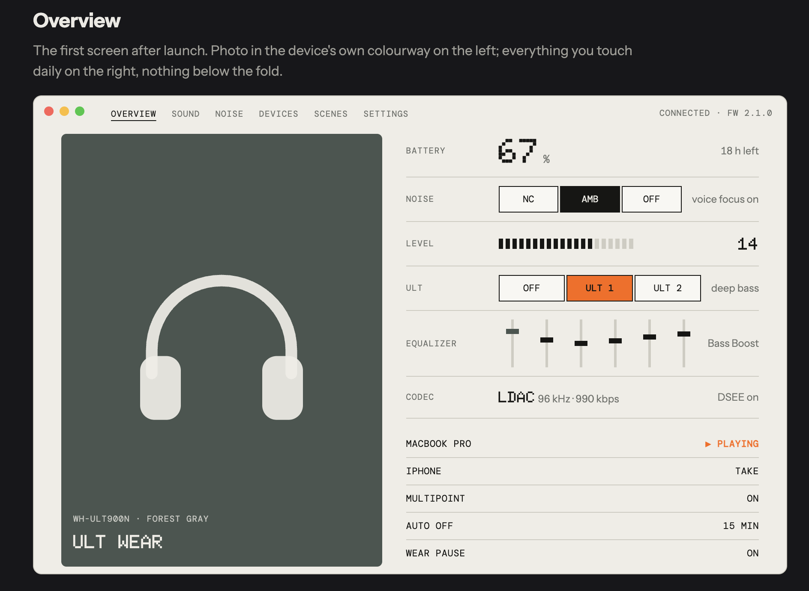
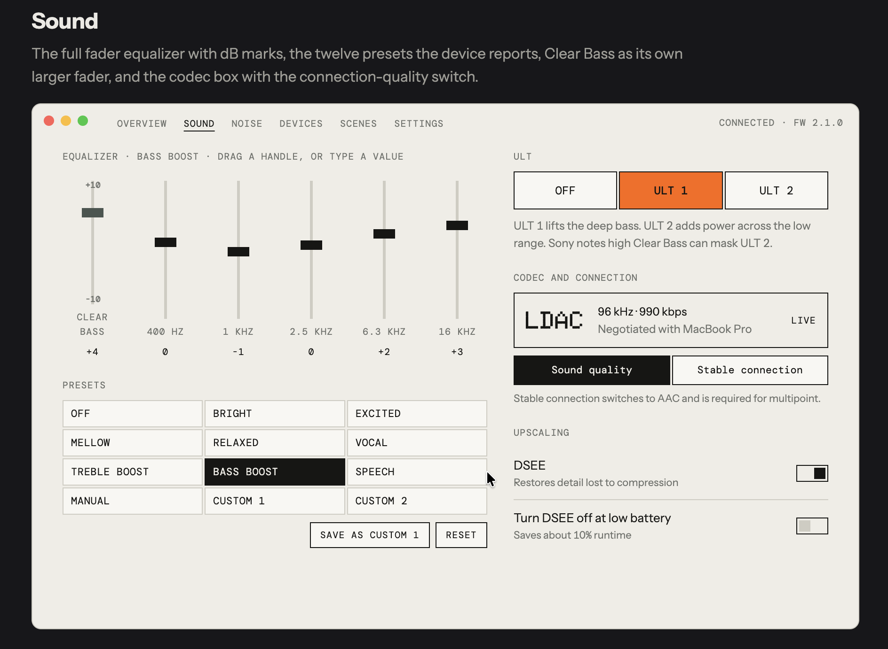
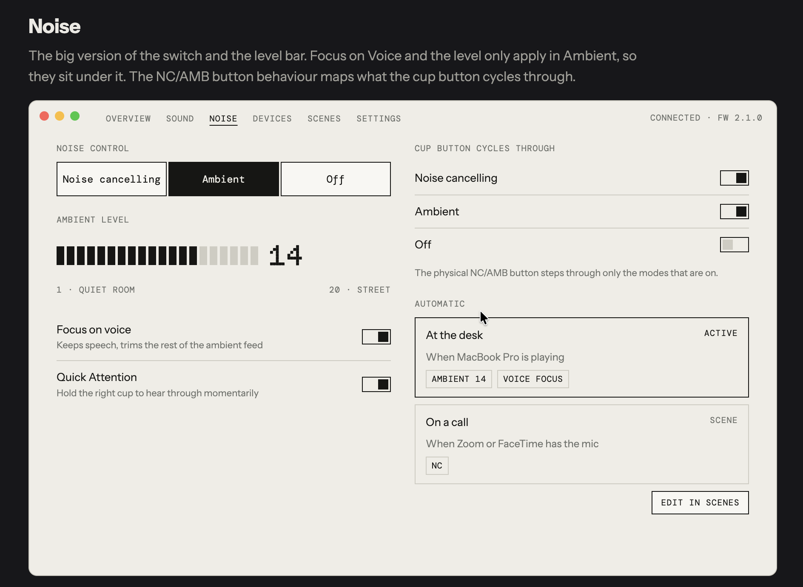
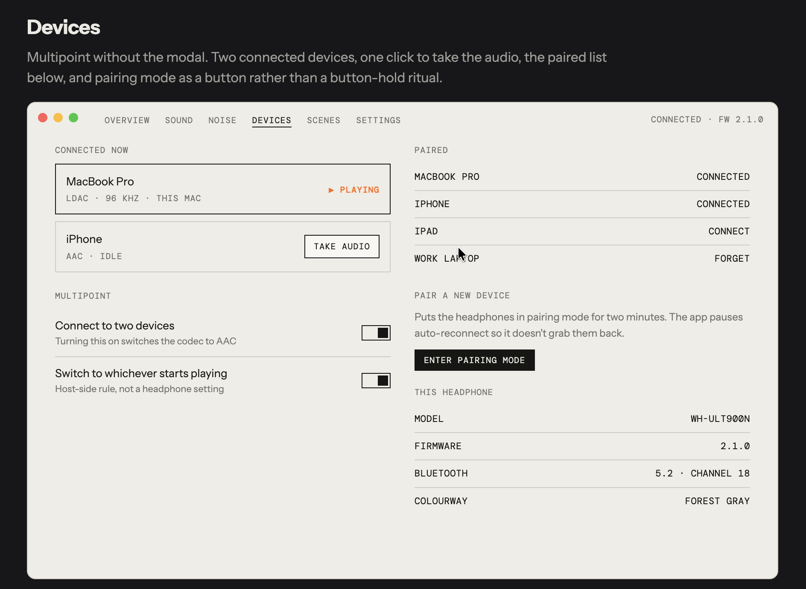
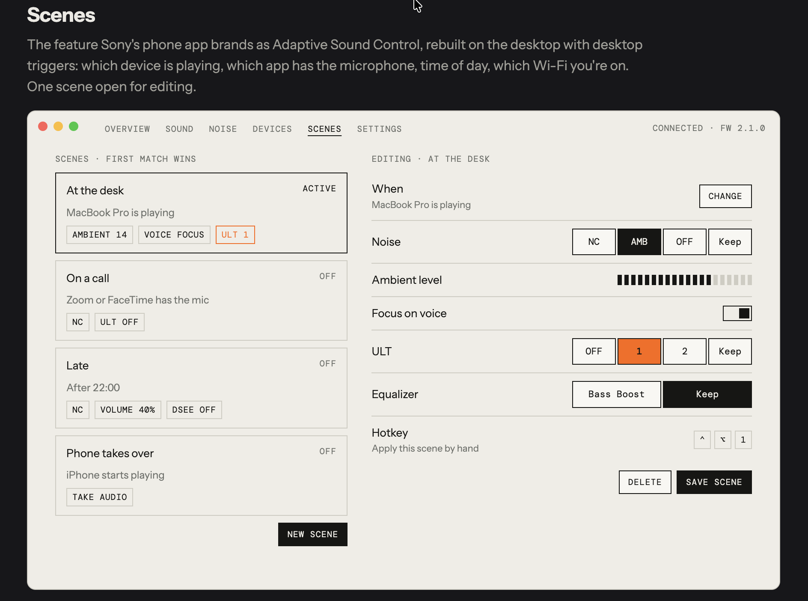
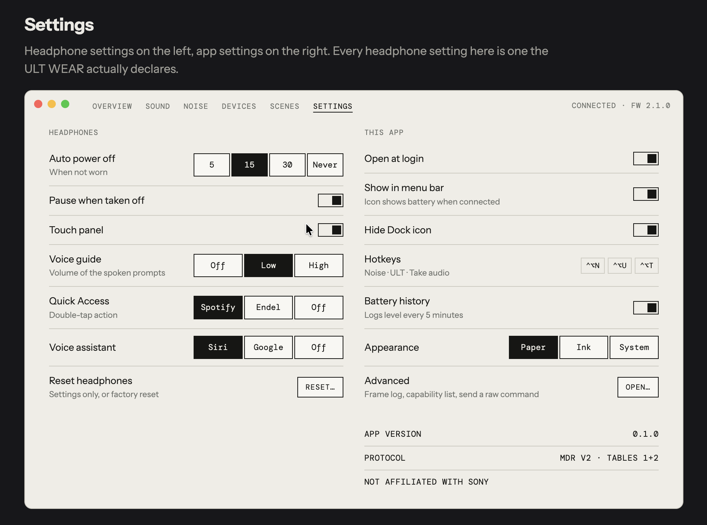

# Hairline

Hairline is a desktop client for Sony ULT WEAR (WH-ULT900N) headphones. It talks to the headphones directly over Bluetooth, without the official phone app, and puts the everyday controls in a small menu-bar popover.

## What it looks like

The Hairline design: off-white paper, one-pixel rules, dot-matrix numerals, boxed switches, and orange only where something is live. The popover is what you use every day from the menu bar; the window is where you set everything else up.

<table>
  <tr>
    <td align="center" width="50%"><br><sub>Menu-bar popover</sub></td>
    <td align="center" width="50%"><br><sub>Overview</sub></td>
  </tr>
  <tr>
    <td align="center"><br><sub>Sound</sub></td>
    <td align="center"><br><sub>Noise</sub></td>
  </tr>
  <tr>
    <td align="center"><br><sub>Devices</sub></td>
    <td align="center"><br><sub>Scenes</sub></td>
  </tr>
  <tr>
    <td align="center" colspan="2"><br><sub>Settings</sub></td>
  </tr>
</table>

The popover shipped in Phase 1 and is validated on real hardware; the window screens arrive in Phase 2, built from these mockups (`docs/research/reports/Hairline design screens.html`). Scenes is still a placeholder.

## Status

Phase 1: a macOS menu-bar popover for the WH-ULT900N with battery level, noise control, ambient sound level and ULT level.

Phase 2: the full window, opened from the popover footer (it loads the app with `?view=main`). It has five screens: Overview, Sound (a draggable six-band equalizer, presets, ULT, codec and DSEE), Noise, Devices and Settings. It also adds Paper, Ink and System themes and launch at login. By default Hairline shows a Dock icon only while the window is open (Settings can keep it there).

Next: the modes module (Scenes). Windows and Linux come after that.

The popover is validated on a real WH-ULT900N (firmware 2.1.4) on macOS 27.2; see `docs/hardware-validation.md`. The Phase 2 screens are verified against the fake device and still need a session with the real headphones. Use `--fake-device` (below) to run without headphones; a fake run says `FAKE` in the popover and the window so it is never mistaken for the real thing.

## Run it

Prerequisites: Rust stable, Node 22, pnpm 10.

```
cd apps/desktop
pnpm install
pnpm tauri dev -- -- --fake-device
```

The double `--` is intentional: the Tauri CLI forwards the first one to cargo, and the second hands `--fake-device` to the app. Setting the environment variable also works:

```
HAIRLINE_FAKE=1 pnpm tauri dev
```

`--fake-device` runs the app against a simulated headphone instead of a real Bluetooth connection, so you can try the popover without the hardware.

## Tests

```
cargo test --workspace
cargo clippy --workspace --all-targets -- -D warnings
cd apps/desktop && pnpm check && pnpm test
```

## Debugging

`HAIRLINE_FRAME_LOG=1` writes every frame and session log line to `captures/local/<YYYY-MM-DD-HHMMSS>.log` (time in UTC).
`HAIRLINE_DEBUG=1` adds the Tauri command `debug_raw(table, hex)` (`table` is `"t1"` or `"t2"`, e.g. `invoke("debug_raw", { table: "t1", hex: "22 00" })`); the deny-list still applies and replies show up in the log.

## Layout

- `crates/mdr-frame`: packet framing, escaping and checksums.
- `crates/mdr-proto`: message encoding and decoding, and the request deny-list.
- `crates/mdr-session`: handshake, acknowledgements and retries, and device state.
- `crates/mdr-transport`: the Bluetooth link to the headphones.
- `apps/desktop`: the Tauri 2 and Svelte 5 app (Rust side in `src-tauri`).

## Safety

Hairline never sends commands on the deny-list, and it only changes a setting the headphones declare as supported. No Advanced path exists yet: in this phase the deny-list cannot be bypassed, except for power off after the user confirms it. The details are in [docs/protocol-notes.md](docs/protocol-notes.md).

## Design

The approved interface is in [docs/research/reports/Hairline design screens.html](<docs/research/reports/Hairline design screens.html>). The full design is in [the spec](docs/superpowers/specs/2026-11-07-ult-wear-desktop-app-design.md).

## License

MIT. Third-party notices are in [THIRD_PARTY.md](THIRD_PARTY.md).

Not affiliated with or endorsed by Sony. Sony, ULT WEAR, DSEE and LDAC are trademarks of their owners.
